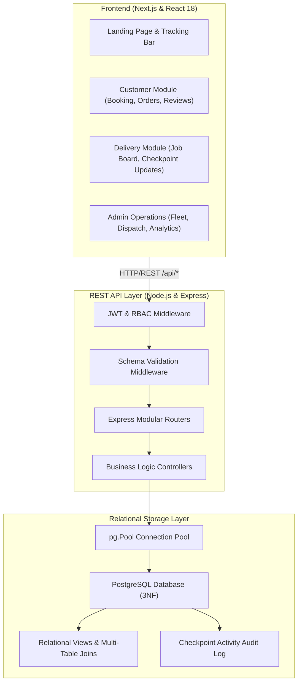
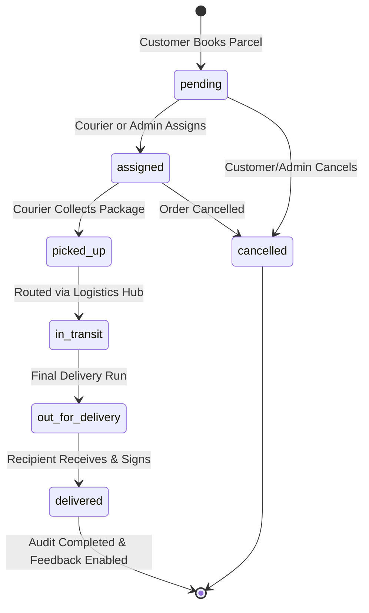

# End-to-End System Design & Architecture
## On-the-Go Courier Management System

### 1. High-Level System Architecture

---

### 2. Role-Based Access Control (RBAC) Matrix

| Resource / Capability | Public | Customer | Courier | Administrator |
| :--- | :---: | :---: | :---: | :---: |
| Public Tracking by Number | ✅ | ✅ | ✅ | ✅ |
| Register Account | ✅ | ✅ | ✅ | ✅ |
| Book Delivery with Live Pricing | ❌ | ✅ | ❌ | ✅ |
| View Own Order History | ❌ | ✅ | ❌ | ✅ |
| Rate Delivered Order | ❌ | ✅ | ❌ | ❌ |
| Accept Unassigned Delivery | ❌ | ❌ | ✅ | ✅ |
| Advance Status Checkpoints | ❌ | ❌ | ✅ | ✅ |
| Toggle Fleet Online/Offline | ❌ | ❌ | ✅ | ✅ |
| View Global Operational KPIs | ❌ | ❌ | ❌ | ✅ |
| Manually Dispatch / Assign Order | ❌ | ❌ | ❌ | ✅ |
| Toggle User Account Activation | ❌ | ❌ | ❌ | ✅ |
| Export Summary Reports | ❌ | ❌ | ❌ | ✅ |

---

### 3. Parcel Lifecycle State Machine

---

### 4. Security & Data Protection Measures
1. **Password Hashing**: Cryptographic salt rounds (10) using `bcryptjs`.
2. **Stateless JWT Tokens**: Signed using `HS256` with expiration and user payload verification.
3. **CORS Isolation**: Controlled cross-origin resource sharing restricted to authorized client origins.
4. **Input Sanitation & Strict Checks**: Validation of incoming coordinates, weights, email patterns, and enum state constraints.
5. **State Progression Enforcement**: Backward state transitions (e.g., delivered &rarr; pending) are rejected by controller verification.
