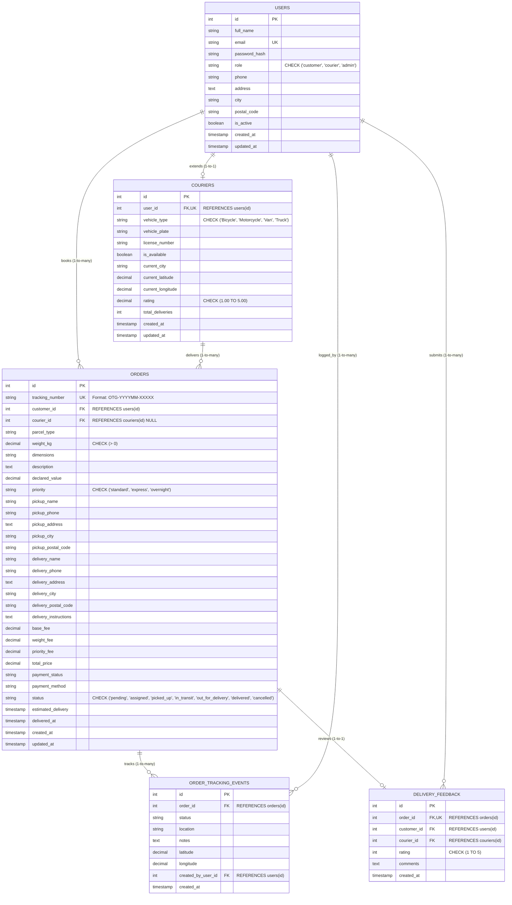

# Relational Database Design & Entity Relationship Diagram (ERD)
## On-the-Go Courier Management System

### 1. Entity-Relationship Diagram (ERD)



---

### 2. Database Normalisation Walkthrough (3NF)

#### First Normal Form (1NF)
- **Primary Keys**: Every entity has a unique identifier (`id` integer primary key).
- **Atomic Values**: Addresses are broken down into `address`, `city`, and `postal_code`; dimensions and weights are isolated into specific columns.
- **No Repeating Groups**: Tracking history events are stored as individual rows in `order_tracking_events` with foreign keys, rather than comma-separated arrays or JSON blobs inside `orders`.

#### Second Normal Form (2NF)
- **Full Functional Dependency**: All non-key attributes depend on the complete primary key.
- Tables with single-column surrogate primary keys (`id`) satisfy 2NF naturally because there are no composite partial key dependencies.
- Courier attributes (vehicle type, license, rating) depend solely on the courier, not on order records.

#### Third Normal Form (3NF)
- **Elimination of Transitive Dependencies**: Non-key attributes depend *only* on the primary key, and not on other non-key attributes.
- Courier vehicle information is placed in `couriers`, not stored inside `orders` alongside `courier_id`.
- Customer profile information (email, password hash, role) is stored in `users`, not duplicated inside `orders`.
- Pricing breakdown (`base_fee`, `weight_fee`, `priority_fee`, `total_price`) is permanently captured at time of booking to ensure immutable billing audits even if platform rates change.

---

### 3. Key Relational SQL Queries & Joins

#### Complex Multi-Table Join View: `v_orders_full`
Demonstrates `INNER JOIN` with customers, `LEFT JOIN` with couriers and user profiles, and `LEFT JOIN` with feedback:
```sql
CREATE VIEW v_orders_full AS
SELECT 
    o.id,
    o.tracking_number,
    o.parcel_type,
    o.weight_kg,
    o.priority,
    o.status,
    o.total_price,
    o.created_at,
    -- Customer Info
    u_cust.id AS customer_id,
    u_cust.full_name AS customer_name,
    u_cust.email AS customer_email,
    u_cust.phone AS customer_phone,
    -- Delivery Route
    o.pickup_city,
    o.delivery_city,
    -- Courier Info (via Couriers JOIN Users)
    c.id AS courier_id,
    u_cour.full_name AS courier_name,
    c.vehicle_type,
    c.vehicle_plate,
    -- Customer Feedback
    df.rating AS feedback_rating,
    df.comments AS feedback_comments
FROM orders o
INNER JOIN users u_cust ON o.customer_id = u_cust.id
LEFT JOIN couriers c ON o.courier_id = c.id
LEFT JOIN users u_cour ON c.user_id = u_cour.id
LEFT JOIN delivery_feedback df ON df.order_id = o.id;
```

#### Courier Performance Aggregation Query: `v_courier_stats`
Demonstrates aggregate functions (`COUNT`, `SUM`, `AVG`, `CASE WHEN`) combined with `GROUP BY`:
```sql
CREATE VIEW v_courier_stats AS
SELECT 
    c.id AS courier_id,
    u.full_name AS courier_name,
    c.vehicle_type,
    c.rating,
    c.total_deliveries,
    COUNT(CASE WHEN o.status IN ('assigned', 'picked_up', 'in_transit', 'out_for_delivery') THEN 1 END) AS active_orders_count,
    COUNT(CASE WHEN o.status = 'delivered' THEN 1 END) AS completed_orders_count,
    COALESCE(SUM(CASE WHEN o.status = 'delivered' THEN o.total_price ELSE 0 END), 0.00) AS total_revenue_delivered
FROM couriers c
INNER JOIN users u ON c.user_id = u.id
LEFT JOIN orders o ON o.courier_id = c.id
GROUP BY c.id, u.full_name, c.vehicle_type, c.rating, c.total_deliveries;
```
